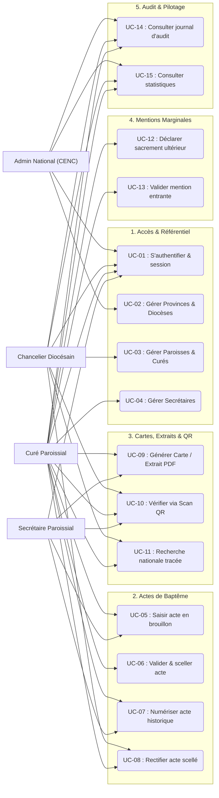

# Spécification des Cas d'Utilisation — SIGEB

> **Système** : Système National de Gestion des Cartes de Baptême (Église Catholique du Cameroun)  
> **Architecture** : API **Spring Boot** · Application **Flutter** (Mobile Android/iOS & Web)  
> **Périmètre détaillé** : Phase 1 (**MVP**) + aperçu Phase 2 (**V2**)

---

## 1. Acteurs du système

| Acteur | Niveau | Rôle principal |
| :--- | :--- | :--- |
| **Admin National (CENC)** | National | Administre le référentiel des provinces et diocèses, crée les comptes chanceliers, supervise l'audit et les statistiques nationales. |
| **Chancelier (Admin Diocésain)** | Diocèse | Gère les paroisses et les comptes curés de son diocèse, approuve les rectifications majeures, suit l'activité diocésaine. |
| **Curé / Administrateur** | Paroisse | Valide et scelle les actes de baptême, gère ses secrétaires, transmet/valide les mentions marginales, délivre cartes et extraits. |
| **Secrétaire Paroissial** | Paroisse | Saisit les brouillons de baptêmes, numérise les anciens registres, imprime les cartes/extraits validés *(ne peut jamais sceller seul un acte)*. |
| **Fidèle / Parent** `[V2]` | Personnel | Consulte sa carte numérique et demande un extrait/duplicata à distance. |
| **Services Externes** *(secondaires)* | Technique | Service email/notifications, passerelle Mobile Money `[V2]`. *(Aucun gestionnaire de fichiers : toutes les données sont stockées dans PostgreSQL.)* |

---

## 2. Vue d'ensemble des Cas d'Utilisation

---

## 3. Catalogue Synthétique

| ID | Cas d'utilisation | Acteurs principaux | Phase |
| :--- | :--- | :--- | :---: |
| **UC-01** | S'authentifier et gérer sa session (FR/EN) | Tous | MVP |
| **UC-02** | Gérer le référentiel national (Provinces, Diocèses, Chanceliers) | Admin National | MVP |
| **UC-03** | Gérer les paroisses et les comptes Curés | Chancelier | MVP |
| **UC-04** | Gérer les comptes Secrétaires paroissiaux | Curé | MVP |
| **UC-05** | Saisir un acte de baptême (Brouillon) | Secrétaire, Curé | MVP |
| **UC-06** | Valider et sceller un acte de baptême (IUN) | Curé | MVP |
| **UC-07** | Numériser un acte historique (Reprise d'archives) | Secrétaire, Curé | MVP |
| **UC-08** | Effectuer une rectification (Avenant tracé) | Curé, Chancelier | MVP |
| **UC-09** | Générer une carte ou un extrait officiel (PDF + QR) | Curé, Secrétaire | MVP |
| **UC-10** | Vérifier une carte par scan QR Code | Curé, Secrétaire, Chancelier | MVP |
| **UC-11** | Effectuer une recherche nationale contrôlée | Curé, Chancelier | MVP |
| **UC-12** | Déclarer un sacrement ultérieur (Mention marginale sortante) | Curé (Paroisse B) | MVP |
| **UC-13** | Valider une mention marginale entrante | Curé (Paroisse A) | MVP |
| **UC-14** | Consulter le journal d'audit | Curé, Chancelier, Admin National | MVP |
| **UC-15** | Consulter les statistiques sacramentelles | Curé, Chancelier, Admin National | MVP |
| **UC-16** | Consulter sa carte numérique personnelle | Fidèle / Parent | V2 |
| **UC-17** | Demander un extrait en ligne (Paiement MoMo / OM) | Fidèle / Parent | V2 |
| **UC-18** | Saisir et synchroniser en mode hors-ligne | Secrétaire, Curé | V2 |

---

## 4. Spécification Détaillée des Cas d'Utilisation (MVP)

### Module 1 — Authentification & Référentiel Ecclésial

#### UC-01 : S'authentifier et gérer sa session
- **Acteurs** : Tous les utilisateurs habilités.
- **Préconditions** : Compte actif créé par l'autorité hiérarchique supérieure.
- **Scénario nominal** :
  1. L'utilisateur saisit son identifiant (email ou téléphone) et son mot de passe sur Flutter (Mobile ou Web).
  2. Le backend Spring Boot vérifie les identifiants, l'état du compte (`ACTIF`) et l'affectation ecclésiale.
  3. Le système émet un couple `Access Token / Refresh Token` (JWT) contenant le rôle et le périmètre (`national`, `dioceseId`, `paroisseId`).
  4. L'interface charge le tableau de bord adapté au rôle et à la langue choisie (**FR / EN**).
- **Exceptions** :
  - *E1 — Identifiants invalides* : Message générique ; verrouillage temporaire après 5 échecs consécutifs.
  - *E2 — Compte suspendu / muté* : Accès refusé immédiatement (révocation des tokens).
- **Postconditions** : Connexion enregistrée dans le journal d'audit.

#### UC-02 : Gérer le référentiel national (Provinces, Diocèses, Chanceliers)
- **Acteur** : Admin National (CENC).
- **Scénario nominal** :
  1. L'Admin crée ou met à jour les 5 provinces ecclésiastiques et les diocèses/archidiocèses (nom FR/EN, code unique ex. `YDE`, `DLA`, `BMD`, siège).
  2. Il crée et affecte un compte **Chancelier** à chaque diocèse.
  3. En cas de changement de chancelier, il désactive l'ancien compte et active le nouveau sans perte d'historique.
- **Règle métier** : Les codes diocésains sont uniques et immuables une fois utilisés dans un Identifiant Unique National (IUN).

#### UC-03 : Gérer les paroisses et les comptes Curés
- **Acteur** : Chancelier (dans le périmètre strict de son diocèse).
- **Scénario nominal** :
  1. Le Chancelier crée une paroisse (nom, code paroisse ex. `P012`, ville/localité, missions/chapelles rattachées, sceau/en-tête officiel).
  2. Il crée le compte du **Curé** (ou Administrateur paroissial) et l'affecte à la paroisse.
  3. En cas de mutation d'un prêtre, le Chancelier transfère son affectation ou révoque son accès sur l'ancienne paroisse.
- **Postconditions** : La paroisse est prête à enregistrer des actes ; l'affectation est historisée.

#### UC-04 : Gérer les comptes Secrétaires paroissiaux
- **Acteur** : Curé (dans le périmètre strict de sa paroisse).
- **Scénario nominal** :
  1. Le Curé crée un compte **Secrétaire Paroissial** (nom, contact, droits de saisie et d'impression).
  2. Il peut activer ou suspendre ce compte à tout moment.
- **Règle métier** : Un Secrétaire n'a jamais le droit de sceller un acte ni d'approuver une mention marginale.

---

### Module 2 — Cycle de Vie de l'Acte de Baptême

#### UC-05 : Saisir un acte de baptême (Brouillon)
- **Acteurs** : Secrétaire Paroissial, Curé.
- **Préconditions** : Utilisateur authentifié et rattaché à une paroisse active.
- **Scénario nominal** :
  1. L'utilisateur ouvre le formulaire de nouvel acte de baptême.
  2. Il renseigne les **données canoniques obligatoires** :
     - **Baptisé** : Nom(s), Prénom(s), nom de baptême, sexe, date et lieu de naissance.
     - **Filiation** : Nom et prénom du père, de la mère (avec option mention confidentielle si adoption/cas canonique).
     - **Parrainage** : Parrain et/ou Marraine (nom, prénom, paroisse/statut).
     - **Célébration** : Date du baptême, lieu (paroisse ou chapelle rattachée), nom du ministre célébrant.
     - **Référence registre papier** : `Tome`, `Page`, `Numéro d'ordre`.
  3. Le système contrôle l'absence de doublon évident (même nom + date de naissance + paroisse) et la cohérence des dates (date baptême ≥ date naissance).
  4. L'acte est enregistré au statut **`BROUILLON`** (ou **`EN_ATTENTE_VALIDATION`** si soumis par le Secrétaire).
- **Alternatives** :
  - *A1 — Doublon potentiel détecté* : Le système affiche une alerte avec la fiche existante avant d'autoriser la poursuite.
- **Postconditions** : L'acte apparaît dans la file « À valider » du Curé.

#### UC-06 : Valider et sceller un acte de baptême
- **Acteur** : Curé / Administrateur Paroissial.
- **Préconditions** : Acte existant dans sa paroisse au statut `BROUILLON` ou `EN_ATTENTE_VALIDATION`.
- **Scénario nominal** :
  1. Le Curé ouvre la fiche soumise et vérifie l'exactitude des champs par rapport au registre physique.
  2. Il clique sur **« Valider & Sceller »** et confirme par ré-authentification (mot de passe ou PIN de signature).
  3. Le système génère automatiquement :
     - L'**Identifiant Unique National (IUN)** : `CM-{DIOCESE}-{PAROISSE}-{ANNEE}-{SEQ}`.
     - Une **empreinte cryptographique** liant les données canoniques à la signature du Curé.
  4. Le statut passe à **`SCELLE`** (verrouillage définitif de l'édition directe).
- **Alternatives** :
  - *A1 — Erreur constatée* : Le Curé renvoie le dossier au Secrétaire (`A_CORRIGER`) avec un motif précis.
- **Postconditions** : L'acte devient officiel, immuable et éligible à l'édition de carte/extrait.

#### UC-07 : Numériser un acte historique (Reprise d'archives)
- **Acteurs** : Secrétaire Paroissial, Curé.
- **Scénario nominal** :
  1. L'utilisateur sélectionne le mode **« Reprise d'acte ancien »**.
  2. Il saisit les données du registre papier (date de baptême antérieure, `Tome / Page / N° d'ordre`, mentions marginales déjà présentes dans la marge).
  3. Le dossier suit le même circuit de validation (`UC-06`) par le Curé, qui contrôle la conformité face au registre physique conservé en paroisse.
- **Règle métier** : L'acte est marqué `ORIGINE = REPRISE_ARCHIVE` et conservé de manière purement structurée en base de données (sans stockage de fichiers).

#### UC-08 : Effectuer une rectification (Avenant tracé)
- **Acteurs** : Curé (erreurs matérielles mineures), Chancelier (modifications majeures : filiation, identité, annulation).
- **Préconditions** : Acte au statut `SCELLE`.
- **Scénario nominal** :
  1. Le Curé ouvre une **demande d'avenant**, sélectionne le(s) champ(s) à rectifier, indique la nouvelle valeur, le motif et la référence du justificatif (ex. n° d'acte d'état civil ou référence registre papier).
  2. Si la rectification est **mineure** (orthographe) : le Curé peut la sceller directement avec justification obligatoire.
  3. Si la rectification est **majeure** (filiation, date/lieu de naissance, changement de nom) : la demande est transmise au **Chancelier Diocésain** pour approbation.
  4. À l'approbation, le système conserve **l'ancienne valeur historisée**, incrémente la version de l'acte et marque les cartes antérieures comme **obsolètes** en base.
- **Postconditions** : Tout scan QR d'une carte antérieure signale automatiquement qu'une rectification a eu lieu.

---

### Module 3 — Cartes, Extraits & Vérification QR

#### UC-09 : Générer et imprimer une carte ou un extrait officiel (sans gestionnaire de fichiers)
- **Acteurs** : Curé, Secrétaire Paroissial.
- **Préconditions** : Acte au statut `SCELLE`.
- **Scénario nominal** :
  1. L'utilisateur choisit le format : **Carte de baptême** (format poche/PVC) ou **Extrait officiel** (format A4, ex. dossier de mariage).
  2. Il choisit la langue du document (**FR / EN**) et le motif de délivrance (première émission, duplicata, mariage, confirmation, séminaire).
  3. Le backend **enregistre en base de données PostgreSQL** une nouvelle entrée de délivrance (`carte_emise`) — **aussi bien pour la 1re émission que pour chaque duplicata** — contenant :
     - Le type d'émission (`ORIGINALE` ou **`DUPLICATA`**, avec `numero_duplicata` incrémenté automatiquement et motif obligatoire : *perte, vol, détérioration, mise à jour*).
     - Les **données exactes imprimées** (IUN, identité du baptisé, paroisse/diocèse, référence registre papier, mentions marginales actives au moment de l'émission, format, langue, date, opérateur, version de l'acte).
     - Les **données utiles à la vérification QR** : identifiant unique de carte, **jeton / signature cryptographique**, empreinte des données imprimées et statut (`ACTIVE`).
  4. En cas de **duplicata** pour perte, vol ou remplacement, la carte précédente est marquée **`REVOQUEE`** (ou `REMPLACEE`) en base tout en conservant son historique.
  5. Le document imprimable (PDF) est **généré à la volée** à partir de ces données pour impression immédiate — **aucun fichier n'est conservé sur le serveur**.
- **Postconditions** : Chaque carte originale et chaque duplicata est enregistré, numéroté et immédiatement vérifiable par scan QR ; la délivrance est journalisée.

#### UC-10 : Vérifier une carte par scan QR Code
- **Acteurs** : Curé, Secrétaire Paroissial, Chancelier.
- **Scénario nominal** :
  1. Depuis l'application mobile Flutter, l'utilisateur scanne le QR Code imprimé sur une carte ou un extrait.
  2. L'application envoie le jeton signé lu dans le QR au backend Spring Boot.
  3. Le système contrôle la signature cryptographique et **interroge en base de données l'enregistrement de la carte imprimée** (`carte_emise`) ainsi que l'état courant de l'acte de baptême.
  4. L'écran affiche immédiatement :
     - Badge **« AUTHENTIQUE »** (vert) ou **« INVALIDE / FALSIFIÉ »** (rouge).
     - Les **données officielles enregistrées de la carte** (identité du baptisé, paroisse/diocèse, date, IUN, date d'émission).
     - **Statut sacramentel / État libre en temps réel** : liste des mentions marginales actives (ex. *Confirmé*, *Marié le...*, ou *Aucune mention de mariage enregistrée*).
- **Exceptions** :
  - *E1 — Jeton inconnu ou signature invalide* : Alerte rouge « Document non reconnu ».
  - *E2 — Carte révoquée / remplacée par un duplicata* : Alerte rouge « Carte révoquée (duplicata émis le …) ».
  - *E3 — Carte obsolète / acte rectifié ou nouvelle mention depuis l'impression* : Alerte orange affichant les nouvelles informations à jour en base.

#### UC-11 : Effectuer une recherche nationale contrôlée
- **Acteurs** : Curé, Chancelier.
- **Préconditions** : Besoin pastoral légitime (ex. fidèle ayant perdu sa carte et préparant un mariage ou une confirmation dans une autre paroisse).
- **Scénario nominal** :
  1. L'utilisateur saisit un **motif obligatoire** (ex. *Préparation mariage*, *Confirmation*, *Parrainage*) et au moins 2 critères (nom + prénom + date de naissance ou IUN).
  2. Le système affiche les résultats correspondants avec des **informations minimales** (nom, année de naissance, diocèse et paroisse d'origine — sans exposer toute la filiation sensible).
  3. Le Curé peut consulter la fiche résumée d'état libre ou envoyer une demande de vérification/extrait à la paroisse d'origine.
- **Règle métier** : Toute recherche hors paroisse est **obligatoirement journalisée** (qui, quand, critères, motif) et visible dans l'audit diocésain.

---

### Module 4 — Mentions Marginales Inter-Paroisses

#### UC-12 : Déclarer un sacrement ultérieur (Mention sortante)
- **Acteur** : Curé de la **Paroisse B** (où est célébré le nouveau sacrement).
- **Préconditions** : Acte de baptême du fidèle retrouvé via scan QR (`UC-10`) ou recherche (`UC-11`).
- **Scénario nominal** :
  1. Le Curé de la Paroisse B clique sur **« Déclarer une mention marginale »** depuis la fiche du baptisé.
  2. Il choisit le type : **Confirmation**, **Mariage** (avec identité du conjoint), **Nullité de mariage**, **Ordination** ou **Vœux perpétuels**.
  3. Il renseigne la date, le lieu, le ministre célébrant et la référence du registre local (ex. registre des mariages).
  4. Il valide l'envoi. Le système crée une mention au statut **`EN_ATTENTE_PAROISSE_ORIGINE`** et notifie le Curé de la **Paroisse A**.
- **Cas particulier** : Si Paroisse B = Paroisse A (même paroisse), la mention est inscrite et scellée directement.

#### UC-13 : Valider une mention marginale entrante
- **Acteur** : Curé de la **Paroisse A** (paroisse de baptême).
- **Préconditions** : Notification d'une mention entrante émise par une Paroisse B.
- **Scénario nominal** :
  1. Le Curé de la Paroisse A ouvre sa boîte de réception « Mentions à inscrire ».
  2. Il vérifie l'identité du baptisé et les informations transmises par la Paroisse B.
  3. Il clique sur **« Approuver & Inscrire en marge »**.
  4. La mention passe au statut **`INSCRITE`**, met automatiquement à jour l'état libre du baptisé et figurera sur tout futur extrait ou scan QR.
- **Alternatives** :
  - *A1 — Erreur d'homonyme / doute* : Le Curé rejette avec motif (`REJETEE`) ; la Paroisse B est immédiatement notifiée.

---

### Module 5 — Audit & Pilotage

#### UC-14 : Consulter le journal d'audit
- **Acteurs** : Curé (sa paroisse), Chancelier (son diocèse), Admin National (tout le pays).
- **Scénario nominal** :
  1. L'utilisateur filtre le journal par date, type d'action (`CREATION`, `SCELLEMENT`, `IMPRESSION`, `SCAN_QR`, `RECHERCHE_NATIONALE`, `RECTIFICATION`, `MENTION`), utilisateur ou IUN.
  2. Le système affiche la piste d'audit **en lecture seule** (horodatage, auteur, rôle, IP/appareil, détail).
- **Règle métier** : Le journal d'audit est **append-only** (aucune suppression ni modification possible, même par l'Admin National).

#### UC-15 : Consulter les statistiques sacramentelles
- **Acteurs** : Curé (paroisse), Chancelier (diocèse), Admin National (CENC).
- **Scénario nominal** :
  1. L'utilisateur sélectionne une période (mois, année pastorale) et un niveau de regroupement.
  2. Le système affiche les compteurs consolidés : nombre de baptêmes célébrés, actes anciens numérisés, confirmations/mariages enregistrés, cartes/extraits délivrés, paroisses actives.
  3. Export possible en **CSV / PDF** pour le rapport pastoral annuel.

---

### Module 6 — Aperçu des Cas d'Utilisation Phase 2 (`[V2]`)

- **UC-16 `[V2]` — Consulter sa carte numérique** *(Fidèle / Parent)* : Accès sécurisé (OTP SMS/Email lié à l'IUN) permettant au fidèle d'afficher sa carte de baptême et son QR Code sur son smartphone.
- **UC-17 `[V2]` — Demander un extrait en ligne avec paiement Mobile Money** *(Fidèle)* : Demande d'extrait officiel à distance, règlement des frais via **MTN MoMo / Orange Money**, validation par le Curé et réception du PDF signé.
- **UC-18 `[V2]` — Saisie hors-ligne & synchronisation** *(Secrétaire / Curé)* : Enregistrement des brouillons en zone rurale sans réseau dans une base locale chiffrée Flutter, puis synchronisation automatique dès le retour de la connexion.

---

## 5. Matrice des Permissions (RBAC)

| Cas d'utilisation | Admin National | Chancelier | Curé | Secrétaire | Périmètre / Règle |
| :--- | :---: | :---: | :---: | :---: | :--- |
| **UC-01** Authentification & session | ✅ | ✅ | ✅ | ✅ | Compte actif uniquement |
| **UC-02** Provinces, Diocèses & Chanceliers | ✅ | — | — | — | Niveau national |
| **UC-03** Paroisses & Curés | 👁️ | ✅ | — | — | Diocèse d'affectation |
| **UC-04** Secrétaires paroissiaux | — | 👁️ | ✅ | — | Paroisse d'affectation |
| **UC-05** Saisir baptême (brouillon) | — | — | ✅ | ✅ | Paroisse d'affectation |
| **UC-06** Valider & sceller un acte | — | — | ✅ | — | Paroisse d'affectation (PIN Curé) |
| **UC-07** Numériser acte historique | — | — | ✅ | ✅ | Brouillon + réf. registre papier |
| **UC-08** Rectification (avenant tracé) | — | ✅ | ✅ | — | Mineure : Curé · Majeure : Chancelier |
| **UC-09** Générer Carte / Extrait PDF | — | ✅ | ✅ | ✅ | Rendu à la volée + données carte/QR en BD |
| **UC-10** Vérifier via Scan QR | — | ✅ | ✅ | ✅ | Vérification temps réel |
| **UC-11** Recherche nationale tracée | — | ✅ | ✅ | — | Motif pastoral obligatoire |
| **UC-12** Déclarer mention sortante | — | — | ✅ | — | Paroisse célébrante (Paroisse B) |
| **UC-13** Valider mention entrante | — | — | ✅ | — | Paroisse de baptême (Paroisse A) |
| **UC-14** Journal d'audit (lecture seule) | ✅ | ✅ | ✅ | — | Périmètre propre (Nat. / Dioc. / Par.) |
| **UC-15** Statistiques sacramentelles | ✅ | ✅ | ✅ | — | Périmètre propre (Nat. / Dioc. / Par.) |

> Légende : **✅** Autorisé · **👁️** Lecture seule · **—** Non autorisé
