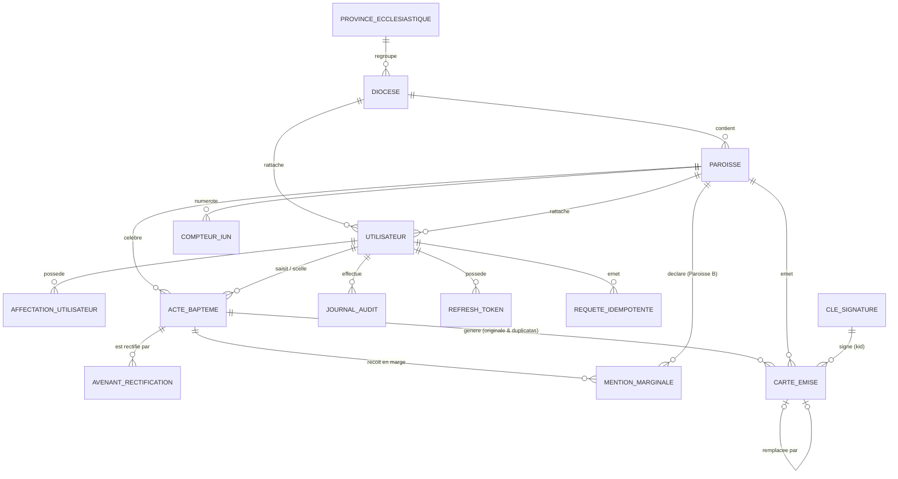

# Modèle Conceptuel & Logique de Données (MCD / MLD) — SIGEB

> **SGBD cible** : **PostgreSQL 16+** (compatible Spring Data JPA / Hibernate + Flyway)  
> **Principe clé** : **100 % base de données** (aucun gestionnaire de fichiers) — les actes, les données imprimées de chaque carte/duplicata, les jetons de vérification QR et l'audit sont intégralement persistés en base.

---

## 1. Principes de modélisation

1. **Hiérarchie ecclésiale stricte** : `province_ecclesiastique` → `diocese` → `paroisse`, portée sur chaque acte et chaque utilisateur pour garantir le cloisonnement RBAC.
2. **Immuabilité canonique** : un `acte_bapteme` au statut `SCELLE` n'est jamais écrasé directement ; toute modification passe par un `avenant_rectification` qui incrémente `version` et conserve les anciennes valeurs.
3. **Cartes, duplicatas & QR en base (`carte_emise`)** : chaque impression (originale ou duplicata) enregistre un instantané des données imprimées, un `numero_duplicata`, un `qr_token` unique et une signature cryptographique. Un duplicata de remplacement révoque automatiquement la carte précédente (`remplacee_par_carte_id`).
4. **Historisation des affectations** : la mutation d'un prêtre ou d'un chancelier n'altère jamais l'historique des actes qu'il a scellés (`affectation_utilisateur`).
5. **Audit `append-only` et chaîné** : `journal_audit` enregistre chaque opération sensible (scans QR, recherches nationales avec motif obligatoire). L'immuabilité est garantie par la base (`REVOKE UPDATE/DELETE`) et par un chaînage de hash entre lignes.
6. **Clés de signature QR versionnées** : `cle_signature` (`kid`) permet la rotation sans invalider les cartes déjà imprimées.
7. **Idempotence & verrouillage optimiste** : `requete_idempotente` évite les doublons dus aux renvois réseau ; `version` protège les mises à jour concurrentes.
8. **Cloisonnement en profondeur** : Row-Level Security PostgreSQL en plus du filtre applicatif (voir §6).

---

## 2. Diagramme Entité-Association (MCD)



---

## 3. Dictionnaire des Entités (14 tables PostgreSQL)

### A. Référentiel Ecclésial & Utilisateurs

#### 1. `province_ecclesiastique`
| Champ | Type PostgreSQL | Contraintes | Description |
| :--- | :--- | :--- | :--- |
| `id` | `UUID` | `PK` | Identifiant unique |
| `code` | `VARCHAR(10)` | `UK, NOT NULL` | Ex. `YDE`, `DLA`, `BMD`, `GRA`, `BTA` |
| `nom_fr` | `VARCHAR(120)` | `NOT NULL` | Nom en français |
| `nom_en` | `VARCHAR(120)` | `NOT NULL` | Nom en anglais |

#### 2. `diocese`
| Champ | Type PostgreSQL | Contraintes | Description |
| :--- | :--- | :--- | :--- |
| `id` | `UUID` | `PK` | Identifiant unique |
| `province_id` | `UUID` | `FK -> province_ecclesiastique, NOT NULL` | Province de rattachement |
| `code` | `VARCHAR(10)` | `UK, NOT NULL` | Code immuable utilisé dans l'IUN (ex. `YDE`, `BAF`) |
| `type_diocese` | `VARCHAR(20)` | `NOT NULL` | `DIOCESE` \| `ARCHIDIOCESE` |
| `nom_fr` / `nom_en` | `VARCHAR(150)` | `NOT NULL` | Dénomination bilingue |
| `siege` | `VARCHAR(100)` | `NOT NULL` | Ville siège de la chancellerie |
| `actif` | `BOOLEAN` | `DEFAULT TRUE` | Statut administratif |

#### 3. `paroisse`
| Champ | Type PostgreSQL | Contraintes | Description |
| :--- | :--- | :--- | :--- |
| `id` | `UUID` | `PK` | Identifiant unique |
| `diocese_id` | `UUID` | `FK -> diocese, NOT NULL` | Diocèse de rattachement |
| `code` | `VARCHAR(10)` | `NOT NULL` | Code unique au sein du diocèse (ex. `P012`) · `UK(diocese_id, code)` |
| `type_paroisse` | `VARCHAR(20)` | `NOT NULL` | `PAROISSE` \| `QUASI_PAROISSE` \| `MISSION` |
| `nom_fr` / `nom_en` | `VARCHAR(160)` | `NOT NULL` | Nom officiel de la paroisse |
| `localite` | `VARCHAR(120)` | `NOT NULL` | Ville / quartier / village |
| `entete_officiel` | `VARCHAR(255)` | `NULL` | Mention imprimée en en-tête de carte/extrait |
| `actif` | `BOOLEAN` | `DEFAULT TRUE` | Statut de la paroisse |

#### 4. `utilisateur`
| Champ | Type PostgreSQL | Contraintes | Description |
| :--- | :--- | :--- | :--- |
| `id` | `UUID` | `PK` | Identifiant unique |
| `identifiant` | `VARCHAR(120)` | `UK, NOT NULL` | Email ou téléphone de connexion |
| `mot_de_passe_hash` | `VARCHAR(255)` | `NOT NULL` | Hash **Argon2id** |
| `pin_signature_hash` | `VARCHAR(255)` | `NULL` | PIN haché **Argon2id** de confirmation de scellement *(Curé / Chancelier)* |
| `totp_secret_chiffre` | `BYTEA` | `NULL` | Secret TOTP chiffré (2FA) |
| `totp_active` | `BOOLEAN` | `DEFAULT FALSE` | **Obligatoire** pour `CURE`, `CHANCELIER`, `ADMIN_NATIONAL` (contrôle applicatif) |
| `mdp_a_changer` | `BOOLEAN` | `DEFAULT TRUE` | Changement forcé à la 1re connexion |
| `nom_complet` | `VARCHAR(160)` | `NOT NULL` | Ex. `Abbé Jean-Paul NKOLO` |
| `telephone` | `VARCHAR(30)` | `NULL` | Contact professionnel |
| `role` | `VARCHAR(25)` | `NOT NULL` | `ADMIN_NATIONAL` \| `CHANCELIER` \| `CURE` \| `SECRETAIRE` |
| `diocese_id` | `UUID` | `FK -> diocese, NULL` | Obligatoire pour Chancelier, Curé, Secrétaire |
| `paroisse_id` | `UUID` | `FK -> paroisse, NULL` | Obligatoire pour Curé et Secrétaire |
| `langue_preferee` | `VARCHAR(2)` | `DEFAULT 'FR'` | `FR` \| `EN` |
| `statut` | `VARCHAR(20)` | `DEFAULT 'ACTIF'` | `ACTIF` \| `SUSPENDU` |
| `tentatives_echec` | `SMALLINT` | `DEFAULT 0` | Verrouillage temporaire après 5 échecs |
| `verrouille_jusqua` | `TIMESTAMPTZ` | `NULL` | Fin du verrouillage (durée croissante à chaque série d'échecs) |
| `cree_le` | `TIMESTAMPTZ` | `NOT NULL` | Horodatage de création |

#### 5. `affectation_utilisateur` *(historique des mutations)*
| Champ | Type PostgreSQL | Contraintes | Description |
| :--- | :--- | :--- | :--- |
| `id` | `UUID` | `PK` | Identifiant unique |
| `utilisateur_id` | `UUID` | `FK -> utilisateur, NOT NULL` | Utilisateur concerné |
| `role` | `VARCHAR(25)` | `NOT NULL` | Rôle exercé durant la période |
| `diocese_id` / `paroisse_id` | `UUID` | `FK, NULL` | Périmètre d'affectation |
| `date_debut` / `date_fin` | `DATE` | `NOT NULL / NULL` | `date_fin IS NULL` = affectation en cours |

---

### B. Actes de Baptême, Avenants & Mentions Marginales

#### 6. `acte_bapteme`
| Champ | Type PostgreSQL | Contraintes | Description |
| :--- | :--- | :--- | :--- |
| `id` | `UUID` | `PK` | Identifiant interne |
| `iun` | `VARCHAR(40)` | `UK, NULL` | Généré au scellement : `CM-{DIOCESE}-{PAROISSE}-{ANNEE}-{SEQ}` |
| `paroisse_id` | `UUID` | `FK -> paroisse, NOT NULL` | Paroisse de baptême (Paroisse A) |
| `origine` | `VARCHAR(20)` | `NOT NULL` | `NOUVEAU` \| `REPRISE_ARCHIVE` |
| `statut` | `VARCHAR(25)` | `NOT NULL` | `BROUILLON` \| `EN_ATTENTE_VALIDATION` \| `A_CORRIGER` \| `SCELLE` |
| `version` | `INTEGER` | `DEFAULT 1, NOT NULL` | Incrémenté à chaque avenant approuvé ; sert aussi de **verrou optimiste** (`@Version`) |
| `nom` / `prenoms` | `VARCHAR(120)` | `NOT NULL` | État civil du baptisé |
| `nom_bapteme` | `VARCHAR(120)` | `NULL` | Prénom chrétien / de baptême si distinct |
| `sexe` | `CHAR(1)` | `NOT NULL` | `M` \| `F` |
| `date_naissance` | `DATE` | `NOT NULL` | Contrainte `date_bapteme >= date_naissance` |
| `lieu_naissance` | `VARCHAR(150)` | `NOT NULL` | Localité de naissance |
| `nom_pere` / `nom_mere` | `VARCHAR(160)` | `NULL` | Filiation canonique |
| `filiation_confidentielle` | `BOOLEAN` | `DEFAULT FALSE` | Masquage restreint (adoption / cas canonique) |
| `nom_parrain` / `nom_marraine` | `VARCHAR(160)` | `NULL` | Au moins un des deux renseigné |
| `paroisse_parrainage` | `VARCHAR(160)` | `NULL` | Paroisse d'origine du parrain/marraine |
| `date_bapteme` | `DATE` | `NOT NULL` | Date de célébration |
| `lieu_bapteme` | `VARCHAR(160)` | `NOT NULL` | Église paroissiale ou chapelle rattachée |
| `ministre_celebrant` | `VARCHAR(160)` | `NOT NULL` | Nom du prêtre/diacre célébrant |
| `registre_tome` | `VARCHAR(20)` | `NOT NULL` | Référence registre physique — Tome |
| `registre_page` | `VARCHAR(20)` | `NOT NULL` | Référence registre physique — Page |
| `registre_numero` | `VARCHAR(30)` | `NOT NULL` | Référence registre physique — N° d'ordre |
| `motif_correction` | `TEXT` | `NULL` | Rempli par le Curé si statut `A_CORRIGER` |
| `saisi_par_id` | `UUID` | `FK -> utilisateur, NOT NULL` | Opérateur de saisie |
| `scelle_par_id` | `UUID` | `FK -> utilisateur, NULL` | Curé ayant scellé l'acte |
| `scelle_le` | `TIMESTAMPTZ` | `NULL` | Date/heure exacte du scellement |
| `empreinte_scellement` | `VARCHAR(64)` | `NULL` | Hash SHA-256 des données canoniques scellées |
| `cree_le` / `modifie_le` | `TIMESTAMPTZ` | `NOT NULL` | Horodatages système |

#### 7. `avenant_rectification` *(UC-08)*
| Champ | Type PostgreSQL | Contraintes | Description |
| :--- | :--- | :--- | :--- |
| `id` | `UUID` | `PK` | Identifiant de l'avenant |
| `acte_bapteme_id` | `UUID` | `FK -> acte_bapteme, NOT NULL` | Acte scellé rectifié |
| `version_cible` | `INTEGER` | `NOT NULL` | Numéro de version résultant (`version + 1`) |
| `gravite` | `VARCHAR(15)` | `NOT NULL` | `MINEURE` *(Curé)* \| `MAJEURE` *(Chancelier)* |
| `anciennes_valeurs_json` | `JSONB` | `NOT NULL` | Valeurs exactes avant rectification |
| `nouvelles_valeurs_json` | `JSONB` | `NOT NULL` | Nouvelles valeurs appliquées |
| `motif` | `TEXT` | `NOT NULL` | Justification canonique/matérielle |
| `reference_justificatif` | `VARCHAR(180)` | `NULL` | Ex. n° acte d'état civil ou réf. registre papier |
| `statut` | `VARCHAR(25)` | `NOT NULL` | `EN_ATTENTE_CHANCELIER` \| `APPROUVE` \| `REJETE` |
| `demande_par_id` / `valide_par_id` | `UUID` | `FK -> utilisateur` | Demandeur (Curé) et approbateur (Curé/Chancelier) |
| `demande_le` / `valide_le` | `TIMESTAMPTZ` | `NOT NULL / NULL` | Dates de workflow |

#### 8. `mention_marginale` *(UC-12 / UC-13)*
| Champ | Type PostgreSQL | Contraintes | Description |
| :--- | :--- | :--- | :--- |
| `id` | `UUID` | `PK` | Identifiant unique |
| `acte_bapteme_id` | `UUID` | `FK -> acte_bapteme, NOT NULL` | Acte de baptême mis à jour (Paroisse A) |
| `paroisse_declarante_id` | `UUID` | `FK -> paroisse, NOT NULL` | Paroisse célébrant le nouveau sacrement (Paroisse B) |
| `type_sacrement` | `VARCHAR(30)` | `NOT NULL` | `CONFIRMATION` \| `MARIAGE` \| `NULLITE_MARIAGE` \| `ORDINATION_DIACONAT` \| `ORDINATION_PRESBYTERAT` \| `VOEUX_PERPETUELS` |
| `date_evenement` | `DATE` | `NOT NULL` | Date du sacrement / décision |
| `lieu_evenement` | `VARCHAR(160)` | `NOT NULL` | Paroisse / lieu de célébration |
| `ministre_celebrant` | `VARCHAR(160)` | `NOT NULL` | Célébrant ou autorité diocésaine |
| `conjoint_nom_complet` | `VARCHAR(180)` | `NULL` | Renseigné si `MARIAGE` ou `NULLITE_MARIAGE` |
| `ref_registre_local` | `VARCHAR(80)` | `NULL` | Réf. du registre local (mariages/confirmations) |
| `statut` | `VARCHAR(25)` | `NOT NULL` | `EN_ATTENTE_ORIGINE` \| `INSCRITE` \| `REJETEE` |
| `declare_par_id` / `valide_par_id` | `UUID` | `FK -> utilisateur` | Curé Paroisse B et Curé Paroisse A |
| `declare_le` / `valide_le` | `TIMESTAMPTZ` | `NOT NULL / NULL` | Horodatages |
| `motif_rejet` | `TEXT` | `NULL` | Obligatoire si `REJETEE` |

---

### C. Cartes Imprimées, Duplicatas & Vérification QR (`UC-09` / `UC-10`)

#### 9. `carte_emise` *(originale & chaque duplicata enregistrés en base)*
| Champ | Type PostgreSQL | Contraintes | Description |
| :--- | :--- | :--- | :--- |
| `id` | `UUID` | `PK` | Identifiant unique de l'émission |
| `acte_bapteme_id` | `UUID` | `FK -> acte_bapteme, NOT NULL` | Acte de baptême source |
| `paroisse_emettrice_id` | `UUID` | `FK -> paroisse, NOT NULL` | Paroisse ayant imprimé la carte |
| `code_carte` | `VARCHAR(30)` | `UK, NOT NULL` | Numéro court lisible imprimé sur la carte (ex. `CRT-2026-8F4A21`) |
| `format_document` | `VARCHAR(20)` | `NOT NULL` | `CARTE` \| `EXTRAIT_A4` |
| `langue` | `VARCHAR(2)` | `NOT NULL` | `FR` \| `EN` |
| `type_emission` | `VARCHAR(15)` | `NOT NULL` | `ORIGINALE` \| `DUPLICATA` |
| `numero_duplicata` | `SMALLINT` | `DEFAULT 0, NOT NULL` | `0` = originale ; `1, 2, 3…` = rang du duplicata (`UK(acte_bapteme_id, format_document, numero_duplicata)`) |
| `motif_emission` | `VARCHAR(30)` | `NOT NULL` | `PREMIERE_EMISSION` \| `PERTE` \| `VOL` \| `DETERIORATION` \| `MISE_A_JOUR` \| `MARIAGE` \| `CONFIRMATION` \| `SEMINAIRE` |
| `version_acte_au_tirage` | `INTEGER` | `NOT NULL` | Version de `acte_bapteme` imprimée sur cette carte |
| `nb_mentions_au_tirage` | `SMALLINT` | `NOT NULL` | Nombre de mentions marginales inscrites au tirage |
| `donnees_imprimees_json` | `JSONB` | `NOT NULL` | **Instantané complet exact imprimé** (IUN, identité, filiation, parrain/marraine, paroisse/diocèse, réf. papier, mentions affichées) |
| `empreinte_donnees` | `VARCHAR(64)` | `NOT NULL` | Hash SHA-256 canonique de `donnees_imprimees_json` |
| `template_version` | `VARCHAR(10)` | `NOT NULL` | Version du modèle graphique de carte/extrait (régénération fidèle du PDF) |
| `qr_token` | `VARCHAR(64)` | `UK, NOT NULL` | Jeton **opaque aléatoire (≥ 128 bits)** encodé dans le QR Code |
| `qr_kid` | `VARCHAR(16)` | `FK -> cle_signature(kid), NOT NULL` | Clé ayant signé ce QR |
| `qr_signature` | `VARCHAR(128)` | `NOT NULL` | Signature HMAC-SHA256 vérifiée au scan avec la clé `qr_kid` |
| `statut` | `VARCHAR(20)` | `DEFAULT 'ACTIVE'` | `ACTIVE` \| `OBSOLETE` \| `REMPLACEE` \| `REVOQUEE` |
| `remplacee_par_carte_id` | `UUID` | `FK -> carte_emise, NULL` | Lien vers le duplicata qui remplace cette carte |
| `revoquee_le` | `TIMESTAMPTZ` | `NULL` | Date de révocation / remplacement |
| `motif_revocation` | `VARCHAR(180)` | `NULL` | Ex. `Duplicata n°1 émis suite à perte` |
| `emis_par_id` | `UUID` | `FK -> utilisateur, NOT NULL` | Curé ou Secrétaire ayant généré le tirage |
| `emis_le` | `TIMESTAMPTZ` | `NOT NULL` | Date/heure exacte d'émission |

---

### D. Audit & Séquence Nationale IUN

#### 10. `journal_audit` *(append-only — UC-14)*
| Champ | Type PostgreSQL | Contraintes | Description |
| :--- | :--- | :--- | :--- |
| `id` | `BIGSERIAL` | `PK` | Séquence chronologique stricte |
| `horodatage` | `TIMESTAMPTZ` | `DEFAULT NOW(), NOT NULL` | Instant de l'événement |
| `utilisateur_id` | `UUID` | `FK -> utilisateur, NULL` | Auteur de l'action |
| `role_utilisateur` | `VARCHAR(25)` | `NOT NULL` | Rôle au moment de l'action |
| `diocese_id` / `paroisse_id` | `UUID` | `NULL` | Périmètre de filtrage audit |
| `type_action` | `VARCHAR(30)` | `NOT NULL` | `CONNEXION`, `CREATION_ACTE`, `SCELLEMENT`, `RECTIFICATION`, `EMISSION_CARTE`, `DUPLICATA`, `REVOCATION_CARTE`, `SCAN_QR`, `RECHERCHE_NATIONALE`, `MENTION_DECLAREE`, `MENTION_VALIDEE` |
| `entite_cible` / `entite_id` | `VARCHAR(40)` / `UUID` | `NULL` | Objet métier concerné |
| `iun_concerne` | `VARCHAR(40)` | `NULL` | Permet de filtrer tout l'historique d'un baptisé |
| `motif` | `TEXT` | `NULL` | **Obligatoire** pour `RECHERCHE_NATIONALE`, `DUPLICATA`, `RECTIFICATION` |
| `details_json` | `JSONB` | `NULL` | Critères de recherche, résumé technique |
| `adresse_ip` | `VARCHAR(45)` | `NULL` | Traçabilité réseau (**hachée** pour les scans anonymes) |
| `hash_precedent` | `CHAR(64)` | `NOT NULL` | Hash de la ligne précédente (chaînage) |
| `hash_ligne` | `CHAR(64)` | `NOT NULL` | SHA-256 de (contenu + `hash_precedent`) ; vérifié chaque nuit |

#### 11. `compteur_iun` *(génération atomique sans doublon)*
| Champ | Type PostgreSQL | Contraintes | Description |
| :--- | :--- | :--- | :--- |
| `paroisse_id` | `UUID` | `PK, FK -> paroisse` | Paroisse concernée |
| `annee` | `SMALLINT` | `PK` | Année du baptême (ex. `2026`) |
| `dernier_numero` | `INTEGER` | `DEFAULT 0, NOT NULL` | Incrémenté via verrou `SELECT ... FOR UPDATE` sur cette seule ligne (aucune contention nationale) |

---

### E. Sécurité Applicative & Fiabilité (v2)

#### 12. `cle_signature` *(clés QR versionnées)*
| Champ | Type PostgreSQL | Contraintes | Description |
| :--- | :--- | :--- | :--- |
| `kid` | `VARCHAR(16)` | `PK` | Identifiant de clé (ex. `K2026A`) |
| `secret_chiffre` | `BYTEA` | `NOT NULL` | Secret HMAC chiffré par la clé maître (hors base) |
| `statut` | `VARCHAR(15)` | `NOT NULL` | `ACTIVE` (signe + vérifie) \| `VERIFY_ONLY` (vérifie seulement) \| `RETIREE` |
| `cree_le` / `retiree_le` | `TIMESTAMPTZ` | `NOT NULL / NULL` | Cycle de vie |

> Contrainte : **une seule** clé `ACTIVE` à la fois (index unique partiel `WHERE statut = 'ACTIVE'`).

#### 13. `refresh_token` *(rotatif, stocké haché)*
| Champ | Type PostgreSQL | Contraintes | Description |
| :--- | :--- | :--- | :--- |
| `id` | `UUID` | `PK` | Identifiant |
| `utilisateur_id` | `UUID` | `FK -> utilisateur, NOT NULL` | Propriétaire |
| `token_hash` | `CHAR(64)` | `UK, NOT NULL` | SHA-256 du jeton (jamais le jeton en clair) |
| `famille_id` | `UUID` | `NOT NULL` | Chaîne de rotation ; réutilisation d'un ancien jeton ⇒ révocation de la famille |
| `expire_le` | `TIMESTAMPTZ` | `NOT NULL` | Expiration |
| `revoque_le` | `TIMESTAMPTZ` | `NULL` | Révocation (mutation, suspension, déconnexion) |

#### 14. `requete_idempotente`
| Champ | Type PostgreSQL | Contraintes | Description |
| :--- | :--- | :--- | :--- |
| `utilisateur_id` | `UUID` | `PK, FK -> utilisateur` | Émetteur |
| `cle` | `UUID` | `PK` | Valeur de l'en-tête `Idempotency-Key` |
| `empreinte_requete` | `CHAR(64)` | `NOT NULL` | Hash méthode + chemin + corps (détecte la réutilisation abusive) |
| `statut_http` | `SMALLINT` | `NULL` | Statut de la réponse mémorisée |
| `reponse_json` | `JSONB` | `NULL` | Réponse rejouée en cas de renvoi |
| `cree_le` | `TIMESTAMPTZ` | `NOT NULL` | Purge automatique après 48 h |

---

## 4. Zoom Technique : Contenu du QR Code & Algorithme de Vérification

### Contenu compact encodé dans le QR Code
Pour rester petit, rapide à scanner (même sur carte PVC) et **ne jamais exposer de données personnelles en clair** à un scanner générique :

```text
SIGEB:v2:{kid}:{qr_token}:{signature_courte}
```

### Vérification côté Spring Boot lors du scan (`UC-10`)
0. **Protection du point d'entrée** : limitation de débit par IP, temps de réponse constant.
1. **Contrôle cryptographique** : charge la clé `kid` (`ACTIVE` ou `VERIFY_ONLY`), recalcule la signature et la compare à `qr_signature` → si clé inconnue, signature invalide ou `qr_token` absent ⇒ **`INVALIDE / FALSIFIÉ`**.
2. **Contrôle du statut de la carte (`carte_emise`)** :
   - Si `statut = REVOQUEE` ou `REMPLACEE` ⇒ **Alerte rouge** (*« Carte révoquée — remplacée par le duplicata `code_carte` du … »*).
3. **Contrôle de fraîcheur face à `acte_bapteme` & `mention_marginale`** :
   - Compare `version_acte_au_tirage` avec `acte_bapteme.version` et `nb_mentions_au_tirage` avec le nombre actuel de mentions `INSCRITE`.
   - Si différence ⇒ **Badge `AUTHENTIQUE — MISE À JOUR DISPONIBLE`** (affiche les nouvelles mentions / rectifications à jour).
   - Sinon ⇒ **Badge vert `AUTHENTIQUE & À JOUR`**.
4. **Niveau de détail de la réponse** :
   - **Scan anonyme** : réponse minimale (`valide`, statut, nom abrégé).
   - **Utilisateur authentifié et autorisé** : détail complet (état libre, mentions, mises à jour).
5. **Journalisation** : insère automatiquement une ligne `SCAN_QR` dans `journal_audit` (IP hachée si anonyme).

---

## 5. Index Critiques & Contraintes PostgreSQL

| Table | Index / Contrainte | Objectif |
| :--- | :--- | :--- |
| `acte_bapteme` | `UNIQUE (iun)` *(partiel `WHERE iun IS NOT NULL`)* | Garantit l'unicité nationale de l'IUN |
| `acte_bapteme` | `UNIQUE (paroisse_id, registre_tome, registre_page, registre_numero)` | Empêche la double saisie d'une même ligne de registre papier |
| `acte_bapteme` | `INDEX (LOWER(nom), LOWER(prenoms), date_naissance)` | Détection anti-doublon rapide & recherche nationale (`UC-11`) |
| `carte_emise` | `UNIQUE (qr_token)` et `UNIQUE (code_carte)` | Vérification QR en **< 5 ms** |
| `carte_emise` | `UNIQUE (acte_bapteme_id, format_document, numero_duplicata)` | Numérotation stricte et sans collision des duplicatas |
| `journal_audit` | `INDEX (horodatage DESC, diocese_id, paroisse_id)` et `INDEX (iun_concerne)` | Filtrage instantané de l'audit par périmètre ou baptisé |
| `cle_signature` | `UNIQUE (statut) WHERE statut = 'ACTIVE'` | Une seule clé de signature active |
| `refresh_token` | `UNIQUE (token_hash)`, `INDEX (utilisateur_id, famille_id)` | Rotation et révocation rapides |
| `requete_idempotente` | `PK (utilisateur_id, cle)`, `INDEX (cree_le)` | Rejeu et purge |

---

## 6. Sécurité en base : Row-Level Security & Droits

### Rôles PostgreSQL
| Rôle | Droits |
| :--- | :--- |
| `sigeb_owner` | Migrations Flyway uniquement (propriétaire du schéma) |
| `sigeb_app` | `SELECT/INSERT/UPDATE` sur les tables métier ; **`INSERT` + `SELECT` seulement** sur `journal_audit` (`REVOKE UPDATE, DELETE, TRUNCATE`) |
| `sigeb_readonly` | `SELECT` pour statistiques / reporting |

### Row-Level Security
- Activée (`ENABLE` + `FORCE ROW LEVEL SECURITY`) sur `acte_bapteme`, `avenant_rectification`, `mention_marginale`, `carte_emise`, `journal_audit`.
- Le backend pose le contexte à chaque transaction : `SET LOCAL app.role`, `app.diocese_id`, `app.paroisse_id`.
- Exemple de politique sur `acte_bapteme` :

```sql
CREATE POLICY cloisonnement ON acte_bapteme
USING (
  current_setting('app.role') = 'ADMIN_NATIONAL'
  OR paroisse_id = NULLIF(current_setting('app.paroisse_id', true), '')::uuid
  OR paroisse_id IN (SELECT id FROM paroisse
                     WHERE diocese_id = NULLIF(current_setting('app.diocese_id', true), '')::uuid)
);
```

- Les accès transversaux légitimes (scan QR, recherche nationale, mentions inter-paroisses) passent par des fonctions `SECURITY DEFINER` dédiées, journalisées et limitées à des colonnes minimales.
