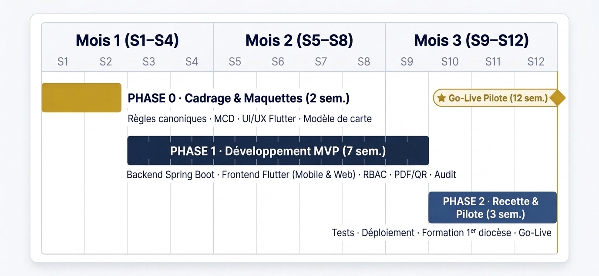

<!-- _class: lead -->
<!-- _header: "" -->
<!-- _footer: "" -->
<!-- _paginate: false -->

# SIGEB — Budget & Délais
## Plan de Réalisation, Coûts & Modèle de Pérennité

**Système National de Gestion des Cartes de Baptême** · Église Catholique du Cameroun

> Proposition budgétaire en **FCFA (XAF)** · Socle **Spring Boot + Flutter (Mobile & Web)**

---

# 1. Synthèse Exécutive (Chiffres Clés)

| Indicateur | Valeur cible | Détail |
| :--- | :--- | :--- |
| **Durée totale MVP** | **3 mois** *(12 semaines)* | De la conception au lancement pilote |
| **Budget Réalisation (CAPEX)** | **3 800 000 FCFA** | Conception, Dev, Sécurité, Déploiement & Pilote |
| **Exploitation annuelle (OPEX)** | **1 060 000 FCFA / an** | Serveur Cloud, sauvegardes, stores & maintenance |
| **Phase 2 — Évolutions (option)** | **+4 à 6 sem.** · **1 500 000 FCFA** | Espace Fidèle, Mobile Money, mode hors-ligne |

> **Approche** : Mise en service rapide sur **1 diocèse pilote** (5 à 10 paroisses) en fin de **Mois 3**, puis généralisation progressive.

---

# 2. Macro-Planning (12 semaines · 3 mois)

> **Méthode** : Livraisons hebdomadaires visibles avec validation continue des règles canoniques et du gabarit de carte.

---

<!-- _class: compact -->
# 3. Jalons & Livrables (S1 à S12)

| Période | Jalon clé | Livrables concrets |
| :--- | :--- | :--- |
| **S1 – S2** | **Cadrage & Maquettes** | Règles canoniques figées, MCD, écrans Flutter (Mobile & Web), gabarit carte |
| **S3 – S4** | **Socle & Référentiel** | API Spring Boot, sécurité JWT/RBAC, hiérarchie Provinces → Paroisses |
| **S5 – S7** | **Baptêmes, PDF & QR** | Saisie actes, validation Curé, génération Carte/Extrait PDF + QR Code signé |
| **S8 – S9** | **Inter-paroisses & Audit** | Mentions marginales, recherche nationale tracée, reprise d'archives, FR/EN |
| **S10 – S11** | **Recette & Déploiement** | Tests sécurité, mise en ligne serveur sécurisé, publication stores |
| **S12** | **Pilote & Go-Live** | Formation curés/secrétaires (1er diocèse), mise en production pilote |

---

<!-- _class: compact -->
# 4. Budget de Réalisation — Phase 1 MVP (CAPEX)

| Poste | Montant (FCFA) | Périmètre inclus |
| :--- | ---: | :--- |
| **Cadrage, Modèle de données & UI/UX** | 350 000 | Spécifications, MCD, maquettes Mobile & Web, gabarit officiel de carte |
| **Backend Spring Boot** | 1 500 000 | API REST, RBAC ecclésial, mentions marginales, PDF/QR signé, journal d'audit |
| **Frontend Flutter (Mobile + Web)** | 1 500 000 | App Android/iOS, interface Web bureau, scanner QR intégré, interface FR/EN |
| **Sécurité, Déploiement & Pilote** | 450 000 | Configuration serveur HTTPS/sauvegardes, guides utilisateurs, formation 1er diocèse |
| **TOTAL MVP (Forfait clé en main)** | **3 800 000** | *Hors frais récurrents d'hébergement et comptes stores* |

> **Échéancier proposé** : **40 %** au démarrage (S1) · **30 %** à la version Beta (S8) · **30 %** au lancement pilote (S12).

---

<!-- _class: compact -->
# 5. Coûts Récurrents (OPEX) & Phase 2

## Exploitation annuelle (continuité & sécurité)

| Poste annuel | Montant / an (FCFA) | Détail |
| :--- | ---: | :--- |
| **Serveur Cloud & Sauvegardes** | 300 000 | VPS dédié performant (App + PostgreSQL + backups chiffrés automatiques) |
| **Domaine, SSL & Notifications** | 80 000 | Nom de domaine national, certificats HTTPS, envoi d'emails/alertes |
| **Comptes Stores (Android / iOS)** | 80 000 | Licences de publication Google Play & Apple Developer |
| **Maintenance & Support Technique** | 600 000 | Correctifs sécurité, mises à jour Flutter/OS, assistance chancelleries |
| **TOTAL OPEX ANNUEL** | **1 060 000** | *Soit environ **88 000 FCFA / mois** pour tout le réseau* |

> **Phase 2 (optionnelle, +4 à 6 semaines)** : **1 500 000 FCFA** *(Espace Fidèle, MTN MoMo / Orange Money, mode hors-ligne, tableaux de bord).*

---

# 6. Financement & Autofinancement National

- **Investissement initial (3 800 000 FCFA)** :
  - Financement direct par le **diocèse pilote**, la **CENC** ou un cofinancement interdiocésain.
- **Autofinancement de l'exploitation (1 060 000 FCFA / an)** :
  - **200 paroisses × 5 500 FCFA / an = 1 100 000 FCFA / an** → exploitation couverte à 100 %.
  - **500 paroisses × 2 500 FCFA / an = 1 250 000 FCFA / an** → excédent réinvesti dans les évolutions.
  - En Phase 2 : contribution symbolique sur les demandes d'extraits numériques (Mobile Money).

> **Bilan** : Un coût annuel par paroisse inférieur à **500 FCFA / mois** à l'échelle nationale.

---

# 7. Options & Facteurs d'Impact

| Option / Facteur | Délai additionnel | Budget additionnel | Recommandation |
| :--- | :---: | :---: | :--- |
| **Mode hors-ligne complet dès la V1** | +2 sem. | +500 000 FCFA | Reporter en Phase 2 |
| **Paiement MTN MoMo / Orange Money** | +2 sem. | +500 000 FCFA | Reporter en Phase 2 |
| **Espace Fidèle grand public** | +2 sem. | +500 000 FCFA | Démarrer par clergé & secrétariats |
| **Validation tardive du gabarit de carte** | +1 sem. | 0 FCFA | Valider le modèle dès S2 |

---

<!-- _class: closing -->
# 8. Décisions pour Démarrer

1. **Valider le périmètre MVP et le budget** (**3 800 000 FCFA** · **12 semaines**).
2. **Désigner le diocèse pilote** (5 à 10 paroisses pour le lancement à S12).
3. **Nommer 1 référent diocésain** pour valider le modèle de carte et suivre les jalons.
4. **Fixer la date de démarrage (S1)** pour lancer immédiatement la conception.

> **Livrable dès S2** : Modèle de données (MCD), maquettes complètes Mobile & Web et prototype de carte de baptême.
