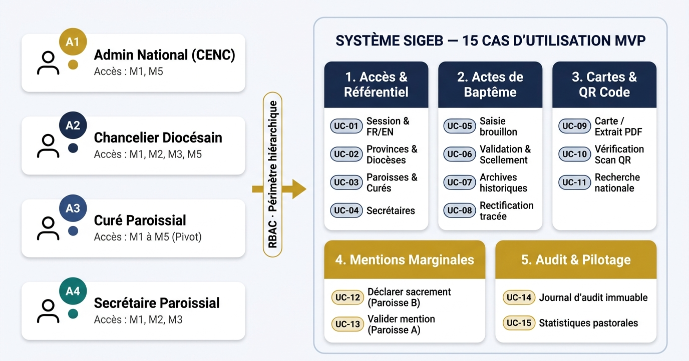
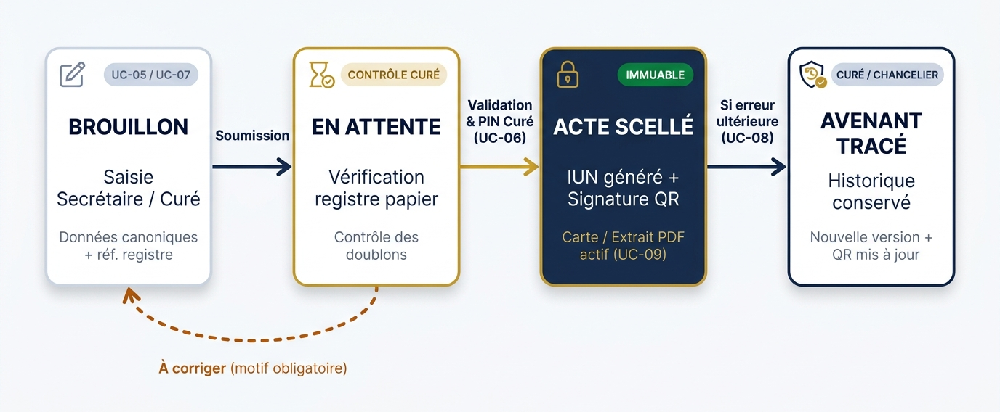
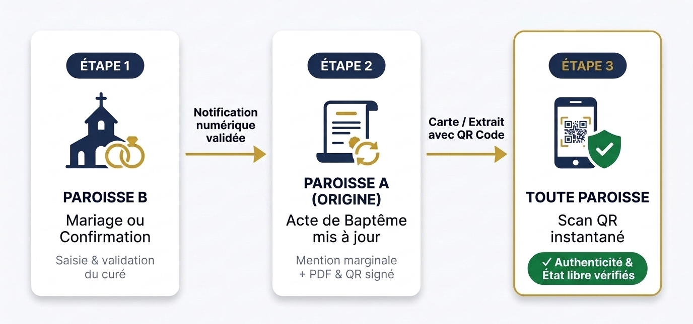

<!-- _class: lead -->
<!-- _header: "" -->
<!-- _footer: "" -->
<!-- _paginate: false -->

# SIGEB — Cas d'Utilisation
## Spécification Fonctionnelle & Matrice RBAC

**Système National de Gestion des Cartes de Baptême** · Église Catholique du Cameroun

> **15 cas d'utilisation MVP** répartis en **5 modules** + **3 évolutions Phase 2**

---

<!-- _class: compact -->
# 1. Acteurs du Système

| Acteur | Niveau | Rôle & Périmètre |
| :--- | :--- | :--- |
| **Admin National (CENC)** | National | Référentiel provinces/diocèses, comptes chanceliers, audit & statistiques nationales |
| **Chancelier Diocésain** | Diocèse | Paroisses et comptes curés, rectifications majeures, suivi diocésain |
| **Curé / Administrateur** | Paroisse | **Acteur pivot** : scellement des actes, gestion secrétaires, mentions marginales, délivrance |
| **Secrétaire Paroissial** | Paroisse | Saisie des brouillons, reprise d'archives, impression *(ne scelle jamais seul un acte)* |
| **Fidèle / Parent** `[V2]` | Personnel | Consultation de sa carte numérique et demande d'extrait en ligne |

---

# 2. Vue Globale des Cas d'Utilisation (MVP)

---

<!-- _class: compact -->
# 3. Module 1 — Accès & Référentiel Ecclésial

| ID | Cas d'utilisation | Acteur | Règles clés |
| :--- | :--- | :--- | :--- |
| **UC-01** | **Authentification & session** | Tous | JWT avec périmètre (`national`, `dioceseId`, `paroisseId`), interface **FR / EN**, verrouillage après 5 échecs |
| **UC-02** | **Provinces, Diocèses & Chanceliers** | Admin National | Gestion des 5 provinces et codes diocésains uniques (`YDE`, `DLA`, `BMD`…) immuables après usage |
| **UC-03** | **Paroisses & Curés** | Chancelier | Création des paroisses/chapelles, affectation ou mutation d'un curé sans perte d'historique |
| **UC-04** | **Comptes Secrétaires** | Curé | Création et suspension des secrétaires paroissiaux (droits limités à la saisie et l'impression) |

---

# 4. Module 2 — Cycle de Vie d'un Acte de Baptême

> **Principe canonique** : Un acte scellé par le Curé devient **immuable** ; toute correction ultérieure génère un **avenant historisé** sans jamais effacer l'original.

---

<!-- _class: compact -->
# 5. Module 2 — Détail des Cas d'Utilisation (`UC-05` à `UC-08`)

- **UC-05 — Saisir un acte (Brouillon)** *(Secrétaire / Curé)* :
  - Données canoniques (baptisé, filiation, parrain/marraine, célébrant, date/lieu, réf. `Tome/Page/N°`) + alerte anti-doublon automatique.
- **UC-06 — Valider & sceller** *(Curé uniquement)* :
  - Confirmation par PIN/mot de passe → génération de l'**IUN** (`CM-YDE-P012-2026-00458`) et de la **signature cryptographique QR**.
- **UC-07 — Reprise d'archives historiques** *(Secrétaire / Curé)* :
  - Saisie d'actes anciens avec les **références exactes du registre papier** (`Tome/Page/N°`, sans stockage de fichiers), vérifiée par le Curé.
- **UC-08 — Rectification (Avenant tracé)** *(Curé / Chancelier)* :
  - Erreur orthographique mineure validée par le Curé ; changement majeur (filiation, identité) soumis au **Chancelier**.

---

<!-- _class: compact -->
# 6. Module 3 — Cartes, Extraits & Vérification QR

| ID | Cas d'utilisation | Fonctionnement & Contrôle |
| :--- | :--- | :--- |
| **UC-09** | **Générer Carte / Duplicata** *(Curé, Secrétaire)* | Rendu **à la volée** (sans fichiers) · Chaque **originale et chaque duplicata** est enregistré en BD (données imprimées, n° duplicata, motif, jeton QR) |
| **UC-10** | **Vérifier via Scan QR** *(Curé, Secrétaire, Chancelier)* | Scan mobile → contrôle cryptographique + vérification en BD (**authentique**, **révoquée/remplacée par duplicata**, ou **état libre à jour**) |
| **UC-11** | **Recherche nationale tracée** *(Curé, Chancelier)* | **Motif pastoral obligatoire** (ex. mariage) + min. 2 critères · Affiche uniquement le résumé utile · **Journalisation systématique** |

---

# 7. Module 4 — Mentions Marginales Inter-Paroisses

> **UC-12 (Paroisse B)** déclare Confirmation, Mariage, Nullité, Ordination ou Vœux → **UC-13 (Paroisse A)** approuve et inscrit en marge, mettant à jour l'état libre immédiatement.

---

# 8. Module 5 — Audit Immuable & Pilotage

- **UC-14 — Journal d'audit (`append-only`)** :
  - Trace chaque action critique (`CREATION`, `SCELLEMENT`, `IMPRESSION`, `SCAN_QR`, `RECHERCHE_NATIONALE`, `RECTIFICATION`, `MENTION`).
  - Lecture seule stricte par périmètre (Paroisse / Diocèse / National) : **aucune suppression possible**.
- **UC-15 — Statistiques sacramentelles** :
  - Indicateurs consolidés par période : baptêmes célébrés, archives numérisées, mentions enregistrées, extraits délivrés, paroisses actives.
  - Export **PDF / CSV** pour les rapports pastoraux annuels.

---

<!-- _class: matrix -->
# 9. Matrice des Permissions RBAC (Spring Security)

| Cas d'utilisation | Admin National | Chancelier | Curé | Secrétaire |
| :--- | :---: | :---: | :---: | :---: |
| **UC-01** Authentification & session FR/EN | ✅ | ✅ | ✅ | ✅ |
| **UC-02** Provinces, Diocèses & Chanceliers | ✅ | — | — | — |
| **UC-03** Paroisses & comptes Curés | 👁️ | ✅ | — | — |
| **UC-04** Comptes Secrétaires paroissiaux | — | 👁️ | ✅ | — |
| **UC-05 · UC-07** Saisie brouillon & reprise d'archives | — | — | ✅ | ✅ |
| **UC-06 · UC-12 · UC-13** Scellement & mentions marginales | — | — | ✅ | — |
| **UC-08** Rectification par avenant tracé | — | ✅ | ✅ | — |
| **UC-09 · UC-10** Cartes/Extraits PDF & Scan QR | — | ✅ | ✅ | ✅ |
| **UC-11** Recherche nationale tracée | — | ✅ | ✅ | — |
| **UC-14 · UC-15** Journal d'audit & statistiques | ✅ | ✅ | ✅ | — |

> **✅** Autorisé *(périmètre propre)* · **👁️** Lecture seule · **—** Non autorisé · *UC-08 : mineure Curé, majeure Chancelier · UC-09 : acte scellé.*

---

<!-- _class: closing -->
# 10. Évolutions Phase 2 (`V2`) & Suite Technique

1. **UC-16 `[V2]` — Espace Fidèle** : Accès mobile sécurisé (OTP) pour consulter sa carte numérique et son QR Code.
2. **UC-17 `[V2]` — Demande d'extrait & Mobile Money** : Commande en ligne avec paiement **MTN MoMo / Orange Money** et délivrance PDF validée par le Curé.
3. **UC-18 `[V2]` — Mode hors-ligne** : Saisie des brouillons sans réseau en zone rurale avec synchronisation automatique chiffrée.

> **Prochaine étape de conception** : Modèle Conceptuel de Données (**MCD / Schéma PostgreSQL**) et spécification des **API REST Spring Boot**.
