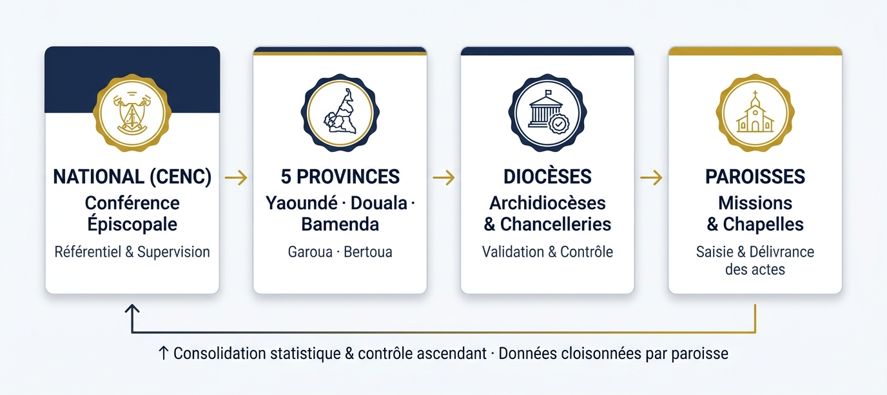
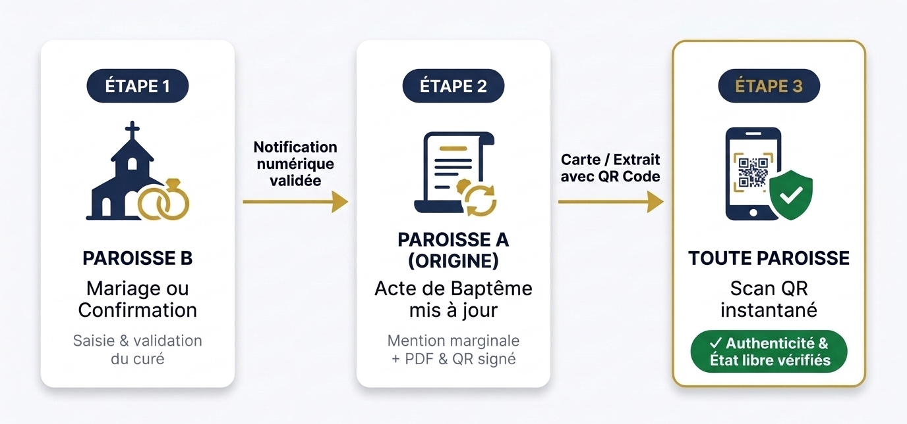

<!-- _class: lead -->
<!-- _header: "" -->
<!-- _footer: "" -->
<!-- _paginate: false -->

# SIGEB
## Système Informatique de Gestion des Cartes de Baptême

**Église Catholique du Cameroun** — Document de Cadrage

> **Architecture** : Backend **Spring Boot** · Frontend unifié **Flutter** (Mobile Android/iOS & Web)

---

# 1. Contexte & Objectif

| Situation actuelle (Papier) | Vision cible (SIGEB National) |
| :--- | :--- |
| Registres physiques exposés aux pertes et dégradations | **Base nationale centralisée**, sécurisée et sauvegardée |
| Cartes cartonnées faciles à perdre ou falsifier | **Cartes & extraits infalsifiables** avec QR Code signé |
| Déplacements coûteux vers la paroisse d'origine | **Délivrance et vérification à distance** sur tout le territoire |
| Mise à jour manuelle lente des mentions marginales | **Synchronisation inter-paroisses** fluide et tracée |

> **Ambition** : Moderniser et sécuriser le registre sacramentel tout en respectant strictement la hiérarchie et le droit canonique.

---

# 2. Modèle Hiérarchique Ecclésial

- **Autonomie locale** : Chaque acte appartient à sa paroisse de célébration.
- **Supervision ascendante** : Consolidation statistique et contrôle au niveau diocésain et national.
- **Cloisonnement** : Aucune consultation libre hors périmètre sans motif tracé.

---

# 3. Règles Métier Clés (Droit Canonique)

- **Identifiant Unique National (IUN)** : Ex. `CM-YDE-P012-2026-00458`, systématiquement lié à la **référence papier** (`Tome / Page / N° d'ordre`).
- **Double contrôle & Immuabilité** :
  - Saisie par le secrétariat → **Validation / Scellement par le Curé**.
  - Un acte validé ne se modifie plus directement : toute erreur passe par une **rectification tracée** (avenant validé).
- **Pivot sacramentel (Can. 535 §2)** : L'acte de baptême centralise **Confirmation**, **Mariage** (ou nullité), **Ordination** et **Vœux perpétuels**.
- **Reprise de l'historique** : Enregistrement rétroactif d'anciens actes avec leurs **références exactes au registre papier** (`Tome / Page / N°`), validé par le Curé.

---

# 4. Mentions Marginales & Vérification QR

> **Impact direct** : Lors d'une préparation au mariage, un prêtre vérifie en **quelques secondes** l'authenticité du baptême et l'absence d'empêchement matrimonial.

---

<!-- _class: compact -->
# 5. Acteurs & Permissions (RBAC)

| Rôle | Niveau | Responsabilités principales |
| :--- | :--- | :--- |
| **Admin National (CENC)** | National | Référentiel provinces/diocèses, supervision technique, statistiques nationales |
| **Chancelier / Admin Diocésain** | Diocèse | Création des paroisses, gestion des accès curés, rectifications majeures |
| **Curé / Administrateur** | Paroisse | Validation et scellement des actes, gestion des secrétaires, délivrance officielle |
| **Secrétaire Paroissial** | Paroisse | Saisie des dossiers, numérisation des archives, impression *(ne scelle pas)* |
| **Fidèle / Parent** *(optionnel)* | Personnel | Consultation de sa carte numérique, demande d'extrait ou duplicata |

---

# 6. Périmètre Fonctionnel : MVP vs Phase 2

| Phase 1 — MVP (Cœur du système) | Phase 2 — Évolutions |
| :--- | :--- |
| Référentiel national & gestion des rôles (RBAC) | **Espace Fidèle** (carte mobile + demandes en ligne) |
| Enregistrement baptêmes + validation Curé | **Paiement mobile** (MTN MoMo / Orange Money) |
| Génération à la volée Cartes/Extraits + **données QR en BD** | **Mode hors-ligne** (zones rurales + sync auto) |
| Vérification QR en base & recherche nationale tracée | **Tableaux de bord pastoraux** avancés |
| Mentions marginales inter-paroisses & audit | |
| Reprise d'historique *(réf. registre papier)* | |

---

# 7. Spécificités du Contexte Camerounais

- **Bilinguisme (Français / Anglais)** :
  - Couverture complète des diocèses francophones et anglophones (interface et documents bilingues dès la conception).
- **Confidentialité & Protection des données** :
  - Données sensibles (filiation, adoption, statut matrimonial) protégées par chiffrement (HTTPS + base sécurisée) et **journal d'audit intégral**.
- **Multi-supports & Connectivité** :
  - Pensé *mobile-first* (smartphones/tablettes sur le terrain) et adapté aux postes fixes via **Flutter Web** (secrétariats et chancelleries).

---

# 8. Architecture Technique Retenue

| Couche | Technologie | Rôle |
| :--- | :--- | :--- |
| **Frontend unifié** | **Flutter** (Android, iOS, Web) | Base de code unique mobile & bureau, scan QR intégré |
| **Backend API** | **Spring Boot** (Java 21) | API REST, règles canoniques, Spring Security (JWT/RBAC), rendu à la volée |
| **Base de données** | **PostgreSQL** *(sans gestionnaire de fichiers)* | Actes, **cartes & duplicatas imprimés**, jetons QR et piste d'audit |
| **Sécurité Cartes** | **Jeton signé + vérification BD** | Contrôle instantané de la carte imprimée et de l'état libre |

---

<!-- _class: closing -->
# 9. Points à Valider Ensemble

1. **Nom officiel** : Confirmez-vous `SIGEB` ?
2. **Accès Fidèles** : Inclus dès la V1 ou démarrage réservé au clergé & secrétariats ?
3. **Bilinguisme FR / EN** : Intégré dès la V1 ?
4. **Mode hors-ligne** : Prioritaire V1 (zones rurales) ou Phase 2 ?
5. **Paiement Mobile Money (MoMo / OM)** : Inclus ou hors périmètre V1 ?
6. **Modèle de carte** : Existe-t-il un gabarit papier CENC officiel à reproduire ?

> **Prochaine étape après validation** : Modèle de données (MCD) · Architecture détaillée · Initialisation Spring Boot & Flutter
